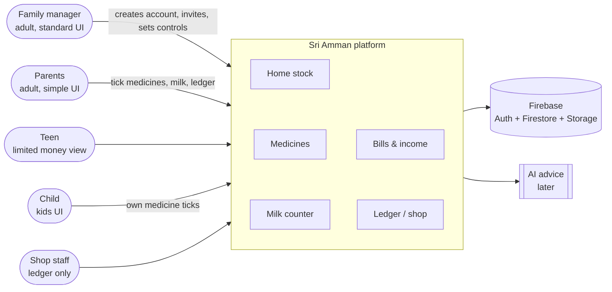
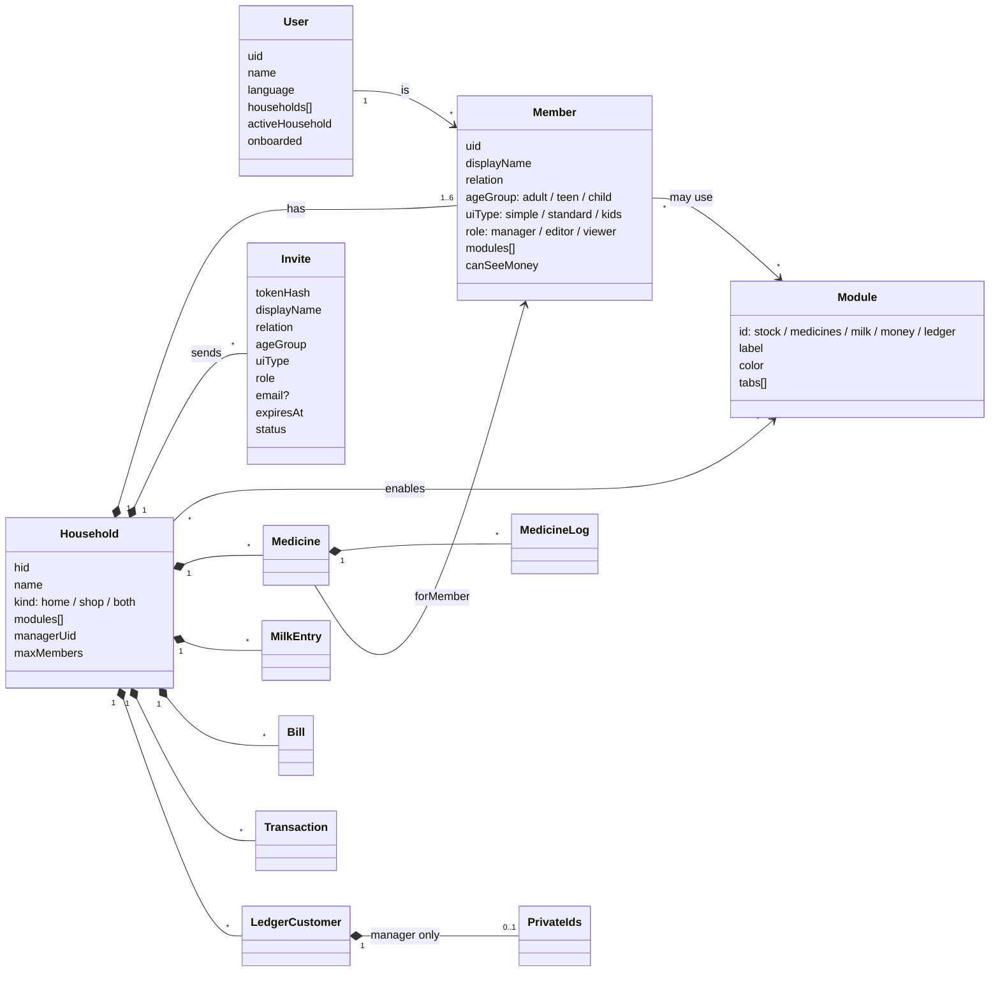
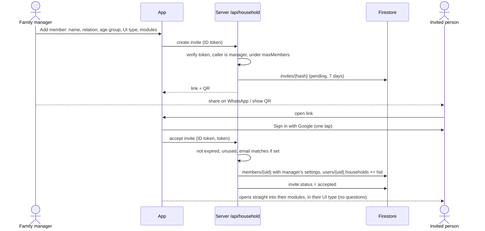
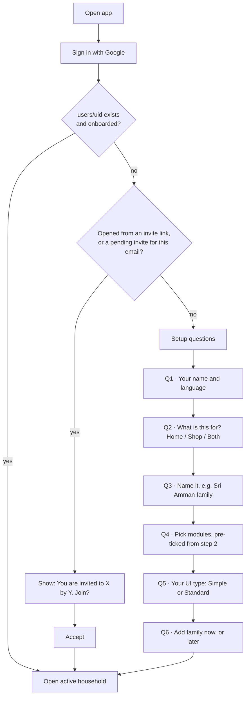
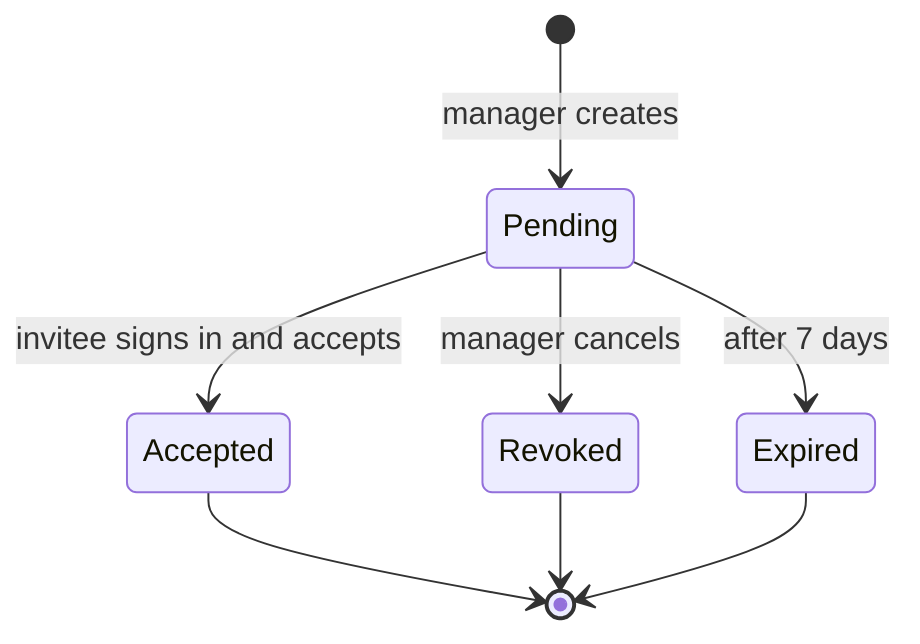
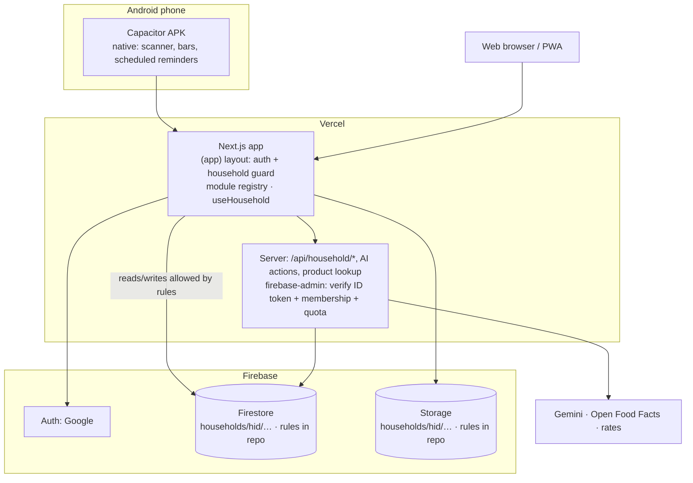
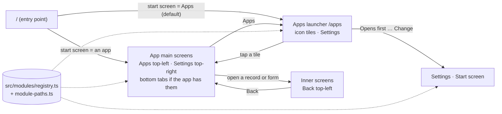

# Sri Amman platform — business architecture

> **Status: proposal, not built yet** (12 Nov 2026). The app today is described in
> [SPEC.md](SPEC.md). This file shows where it is going: one secure app that many families can
> use, with a family manager who adds people the way YouTube Premium Family does.
>
> **Built so far (19 Nov 2026):** the Apps launcher and module registry (diagram H), and simple
> per-account versions of Medicines, Milk and Money (specs 09–11), stored under `users/{uid}/…`.
> Households, family members and sharing below are still a proposal.
>
> To see the diagrams in VS Code, open this file and press **Ctrl+Shift+V** (Markdown preview).
> If they show as code, install the "Markdown Preview Mermaid Support" extension
> (`bierner.markdown-mermaid`). GitHub renders them without any extension.

## At a glance
- **One app, many households.** A household is a family, a shop, or both. All its data stays inside
  it, and nobody outside can read it.
- **A family manager** creates the household and adds people. For each person they set the
  **relation** (mother, son…), the **age group** (adult, teen, child), and the **UI type** (simple,
  standard, kids). This works like parental controls.
- **Invited people only sign in with Google.** They answer no questions and land in their own
  screens.
- **A first-time user with no invite** answers six short setup questions.
- **Modules:** Home stock, Medicines, Milk counter, Bills & income, and Ledger (shop). The manager
  turns them on for the household and for each person.
- **Stack stays the same:** Next.js on Vercel, Firebase (Auth, Firestore, Storage) and the Android
  APK. A server layer is added for invites and checks.

## 1. The family plan (how accounts work)
One person, the **family manager**, creates the account and adds the others. For each person they
choose a **relation** (mother, son, …), an **age group**, and a **UI type**, which works like
parental controls. Invited people only tap the link and sign in with Google; they answer no
questions. Only someone signing up for the first time **without** an invite gets a short set of
setup questions.

- `households/{hid}`: `name`, `kind` (`home` | `shop` | `both`), `modules: string[]` (enabled),
  `managerUid`, `maxMembers` (default 6), `createdAt`.
- `households/{hid}/members/{uid}`:
  - `displayName`, `relation` (`self` | `spouse` | `father` | `mother` | `son` | `daughter` |
    `grandfather` | `grandmother` | `brother` | `sister` | `staff` | `other`)
  - `ageGroup` (`adult` | `teen` | `child`): decides **what they may see and change**
  - `uiType` (`simple` | `standard` | `kids`): decides **how the app looks** (simple = big
    buttons, number pad, Tamil first; kids = only their own medicine ticks and milk)
  - `role` (`manager` | `editor` | `viewer`), `modules?: string[]` (per-person on/off),
    `canSeeMoney: boolean`, `language`, `joinedAt`
  - The relation fills in sensible defaults, which the manager can change. For example,
    father/mother → adult + simple + editor; son/daughter → asks for the age group;
    child → kids + viewer + no money.
- `invites/{tokenHash}`: `hid`, `invitedBy`, `displayName`, `relation`, `ageGroup`, `uiType`,
  `role`, `modules`, `email?` (when set, only that Google account can accept), `expiresAt` (7 days),
  `status` (`pending` | `accepted` | `revoked` | `expired`). Single use; only the hash is stored.
- `users/{uid}`: `name`, `language`, `households: string[]`, `activeHousehold`, `onboarded`.
  A person can belong to more than one household (e.g. their home and their shop) and switch
  between them in Settings.
- **Manager controls** (Settings → Family): add, edit or remove a member, change their relation,
  age group, UI type, modules and money visibility, resend or revoke an invite, and hand over the
  manager role. Any member can leave.
- All module data lives under `households/{hid}/…`. There are no global collections except
  `barcodes` (product names, no family data), `invites` (server-only) and `users`.

## 2. Diagrams

### A. Who uses it (context)

### B. Domain model (class diagram)

### C. Invite and join (sequence)

### D. First sign-in decision (flowchart)

### E. Invite lifecycle (state)

### F. What each person sees (default permissions)
| | Stock | Medicines | Milk | Bills & income | Ledger | Family settings |
|---|---|---|---|---|---|---|
| Manager | edit | edit | edit | edit | edit | manage |
| Adult editor (e.g. parents) | edit | edit | edit | edit if `canSeeMoney` | edit | view |
| Viewer | view | view | view | view if `canSeeMoney` | view | view |
| Teen | view | own + view | view | own expenses | hidden | hidden |
| Child (kids UI) | hidden | own ticks | view | hidden | hidden | hidden |
| Staff | hidden | hidden | hidden | hidden | edit | hidden |

Firestore rules and the server routes enforce this table; the UI only hides what the rules
already block.

### G. System layers (deployment)

### H. Navigation (built, 19 Nov 2026)
This part already exists in the app (SPEC §5 Navigation). New apps from section 4 plug into it as
one registry entry each.

## 3. Security model (defence in depth)
- **Firestore rules, in the repo, generic and membership-based.** No emails in the rules.
  - Helpers: `member(hid)` (a `get()` of the member doc), `role in [...]`, `moduleOn(hid, m)`,
    `ageAllows(m)`.
  - One `match /households/{hid}/{module}/{doc=**}` pattern, plus per-collection validation of the
    fields being written (types, sizes, `createdBy == uid`, immutable `createdBy`/`hid`).
  - Clients can never write `members` or `households.modules`. Those go through the server.
- **Sensitive data split.** `ledgerCustomers/{id}/private/ids` holds the ID numbers and photos. It
  is readable only by owner/admin, loaded only on the customer screen, and never in lists. Photos move to
  Firebase Storage under `households/{hid}/…` with `storage.rules` in the repo (no public
  download URLs; served via `getBlob`/short-lived URLs).
- **Server side.** Add `firebase-admin` (after the required security scan) in `src/server/`:
  - `verifyUser(req)`: checks the Firebase ID token and membership. Every API route and server
    action calls it; the AI actions also check a per-household daily quota (counter doc via Admin).
  - Membership changes, invites, household creation and the module toggle go through
    `/api/household/*` routes using Admin. Rules deny them from clients.
- **Remove the client allowlist.** `SRIAMMAN_ALLOWED_EMAILS` leaves `next.config` `env` (it stays
  server-only as an optional beta sign-up gate). `next.config.ts` is deleted (keep `.mjs`).
- **One auth guard.** Move every signed-in route into an `src/app/(app)/` route group whose
  `layout.tsx` enforces auth and household membership, replacing per-page `withAuth`. URLs don't
  change, so `/kirayabook` stays.
- **Device hygiene.** Sign-out clears the Firestore IndexedDB cache (`clearIndexedDbPersistence`)
  and the in-memory caches.
- Later (before opening to the public): Firebase App Check, a privacy policy, data export and delete for
  India's DPDP Act, and audit fields (`updatedBy`, `updatedAt`) on every write.

## 4. Modules and their data
- **Medicines** (moves out of stock items):
  - `medicines/{id}`: name, dose, `times[]`, `days`, `forMember`, `pillsLeft`, `refillAt`.
  - `medicineLogs/{date_med_time}`: taken / missed and who ticked it.
  - **Real reminders:** schedule repeating native notifications with Capacitor
    `LocalNotifications.schedule({ on: {hour, minute} })`. This needs **APK 1.6** (exact-alarm and
    boot permissions, plus re-scheduling on boot). The web keeps an in-app fallback.
- **Milk:**
  - `milkSuppliers/{id}`: name, rate/litre with history, default litres.
  - `milkEntries/{yyyy-mm-dd_supplier}`: litres, skipped. One tap confirms the default; the
    number pad changes it.
  - The month bill is computed and shown in the shareable bill style from `lib/bill.ts`.
- **Bills & income:**
  - `bills/{id}`: name, category, amount, due day, frequency.
  - `payments/{id}`; `transactions/{id}`: type (income/expense), category, amount, date, member.
  - Shows a monthly summary and due-soon alerts. This data later feeds the AI-advice module.
- **Ledger:** the current customers, items and rentals move under the household
  (`ledgerCustomers`, `ledgerItems`, `ledgerRentals`); the rental flag becomes a household module
  setting instead of a build-time env var.

## 5. Roadmap (each phase is shippable)
0. **Hardening now, no data-model change**:
   - the `(app)` auth layout
   - an ID-token check on the AI actions and `product-lookup`
   - stop inlining the allowlist
   - fix the `inventory` userId rule
   - `firestore.rules` and `storage.rules` in the repo
   - clear IndexedDB on sign-out
   - delete `/add`'s direct writes and the duplicate `next.config.ts`
   - add an ESLint config
1. **Platform core and family plan:**
   - households, members (relation, age group, UI type, role), `useHousehold`, the registry, the
     data layer and the new rules
   - Settings → Family (manager controls), invite link/QR + accept route, the first-sign-in
     decision (diagram D) and the setup questions
   - then the migration. Personal and Ledger keep working.
2. **Medicines** + APK 1.6 native reminders.
3. **Milk counter.**
4. **Bills & income.**
5. **Open sign-up to the public:** App Check, per-household quotas, privacy policy, data export
   and delete (DPDP), a member limit per plan and, later, paid plans.
   (AI monthly advice comes after this, once data exists.)
